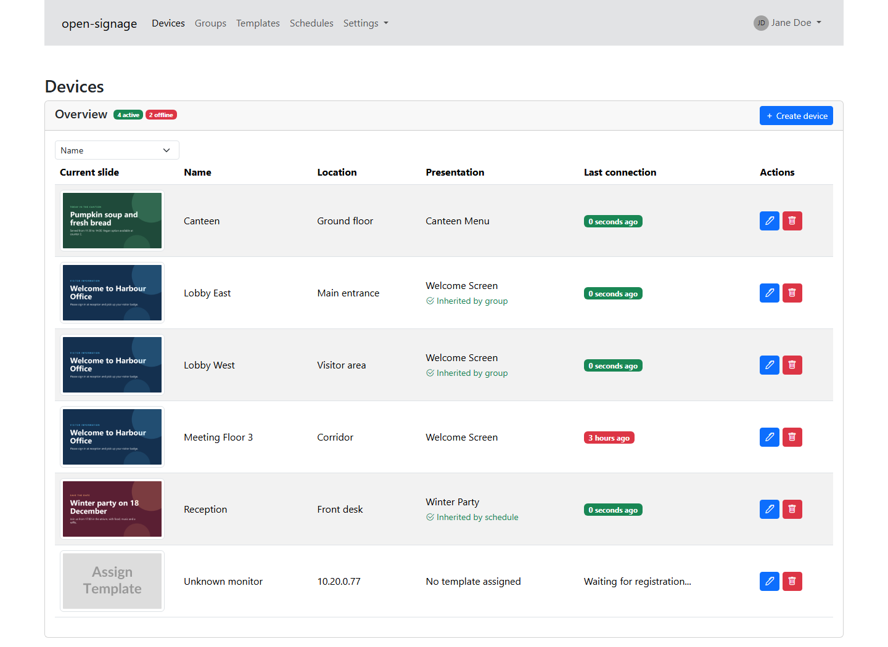
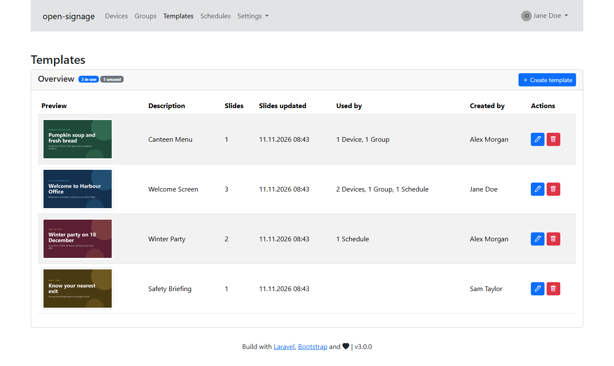
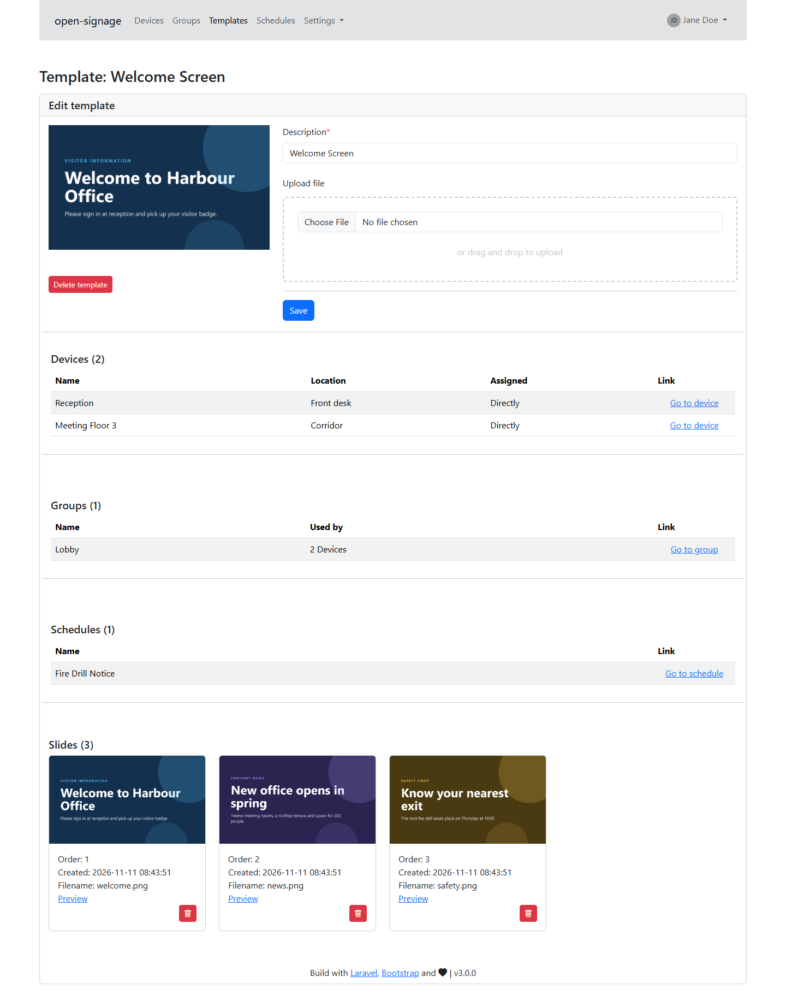
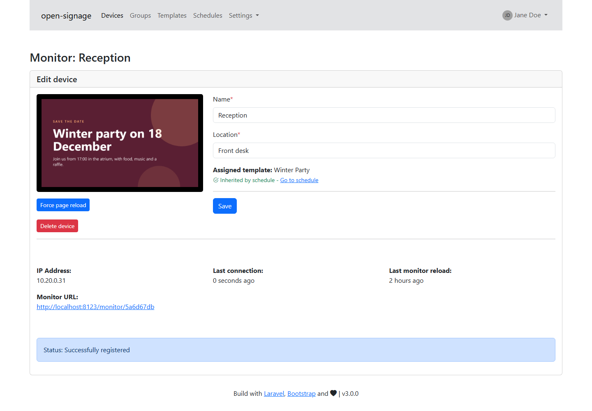
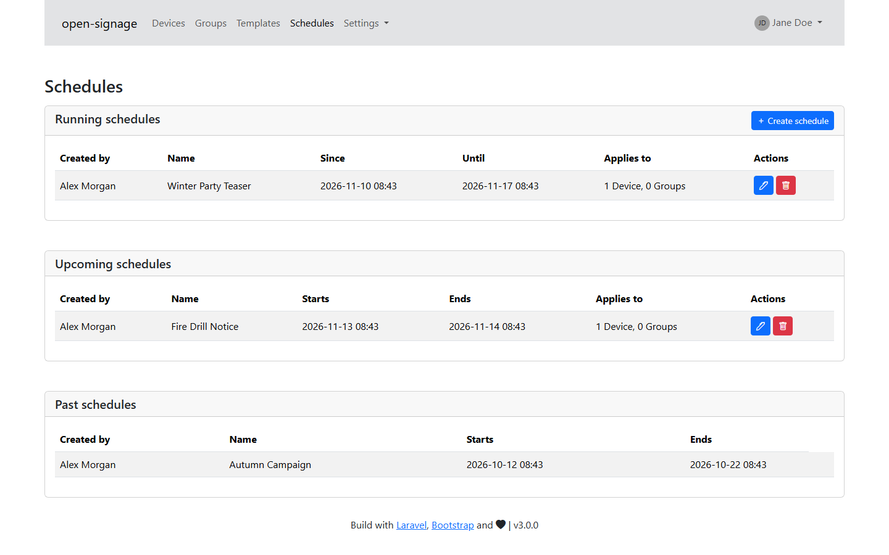

<h1 align="center">open-signage</h1>

<p align="center">Browser-based digital signage, managed from one web interface and built with Laravel.</p>

<p align="center">
  <a href="https://github.com/bluecraank/open-signage/actions/workflows/docker-publish.yml"></a>
</p>

Upload a PDF or MP4, assign it to your screens, and every screen updates by itself. A screen only needs a web browser, there is nothing to install on it.



## Contents

- [Screenshots](#screenshots)
- [Features](#features)
- [How it works](#how-it-works)
- [Requirements](#requirements)
- [Installation with Docker](#installation-with-docker)
- [Native installation](#native-installation)
- [Configuration](#configuration)
- [Setting up monitors](#setting-up-monitors)
- [Roles and permissions](#roles-and-permissions)
- [Monitor settings](#monitor-settings)
- [Updating](#updating)
- [Development](#development)
- [License](#license)

## Screenshots

| Templates | Template details |
| --- | --- |
|  |  |
| **Device** | **Schedules** |
|  |  |

What a monitor shows:


## Features

- PDF presentations are converted to one image per page, MP4 files play as video
- Assign content to single monitors, to groups, or for a limited time with schedules
- Synchronized groups, where every monitor shows the same slide at the same time
- Monitors pick up changes on their own, and can be reloaded remotely
- Zero-touch rollout through a single discover URL that recognizes monitors by IP address
- Login through Active Directory (LDAP), with optional single sign-on
- Role-based permissions and an audit log of actions in the interface
- English and German interface

## How it works

1. Export your presentation as PDF (or use an MP4) and upload it as a template. A background process creates the slides.
2. Open `/discover` on a monitor. The monitor appears in the device list and waits for approval.
3. Accept the monitor in the interface and assign a template directly, through a group, or through a schedule.
4. The monitor shows the slides and reloads whenever its content changes.

If several assignments apply to a monitor, the most specific active one wins:

| Priority | Source |
| --- | --- |
| 1 | Active schedule that names the monitor |
| 2 | Active schedule that names the monitor's group |
| 3 | The monitor's group |
| 4 | Template assigned directly to the monitor |

A schedule can delete its template when it ends. The template is kept if a device, a group or another schedule still uses it.

No cron job or queue worker is required. Uploads are processed by a background process, and finished schedules are cleaned up when a monitor next reports to the server.

### Synchronized groups

Turn on **Synchronize monitors** in a group to show the same slide on all of its monitors at the same time, for example on a video wall or several screens in one room. Each monitor works out the current slide from the server clock, so a monitor that starts or reloads later joins at the right slide. Image slides last for the configured slide interval, and video slides last as long as the video. The slideshow starts from the first slide whenever the template is updated.

All monitors of the group must be able to load every video. A monitor that cannot read a video's length falls back to the slide interval and runs out of step.

## Requirements

**Server**

- Docker, or Linux with PHP 8.3 or newer
- An Active Directory server, because local accounts are not supported
- MySQL or SQLite

**Monitors**

- Any device with a web browser and JavaScript
- A Raspberry Pi 3B or newer works. Raspberry Pi 2B and Zero 2W are not supported
- At least 1 GB of memory is recommended, more for presentations with many slides

## Installation with Docker

Pre-built images are published to `ghcr.io/bluecraank/open-signage`.

1. Copy the example file:

   ```bash
   cp docker-compose.example docker-compose.yml
   ```

2. Edit `environment` in `docker-compose.yml`. See [Configuration](#configuration) for the options. Change the database password and set a fixed `APP_KEY`, otherwise all users are logged out after every image update. You can generate a key with:

   ```bash
   docker run --rm ghcr.io/bluecraank/open-signage:master php artisan key:generate --show
   ```

3. The example expects an existing reverse proxy network. Create it if needed, then start the stack:

   ```bash
   docker network create int_proxy
   docker compose up -d
   ```

4. Create the database tables and the default data:

   ```bash
   docker exec open-signage php artisan migrate --force
   docker exec open-signage php artisan db:seed --force
   ```

5. Point your reverse proxy at the `open-signage` container on port 8080, then set up [the reverse proxy options](#reverse-proxy).

The **first user who logs in becomes Super Administrator**, so log in with your own account right after installing.

To build the image yourself, run `docker build -t open-signage .` and change `image` in `docker-compose.yml`.

## Native installation

1. Install the dependencies. On Debian or Ubuntu, for example:

   ```bash
   apt install php8.4 php8.4-imagick php8.4-mbstring php8.4-curl php8.4-ldap php8.4-bcmath php8.4-xml php8.4-mysql php8.4-sqlite3 ghostscript composer npm
   ```

2. Allow ImageMagick to read PDF files and raise its resource limits. Adjust the path for ImageMagick 7:

   ```bash
   POLICY=/etc/ImageMagick-6/policy.xml
   sed -ri 's/rights="none" pattern="PDF"/rights="read|write" pattern="PDF"/' $POLICY
   sed -ri 's/(name="memory" value=)"256MiB"/\1"2GiB"/' $POLICY
   sed -ri 's/(name="map" value=)"512MiB"/\1"8GiB"/' $POLICY
   sed -ri 's/(name="disk" value=)"1GiB"/\1"8GiB"/' $POLICY
   ```

3. Install the application:

   ```bash
   git clone https://github.com/bluecraank/open-signage
   cd open-signage
   composer install --no-dev --optimize-autoloader
   npm install
   npm run build
   cp .env.example.productive .env
   php artisan key:generate
   ```

4. Edit `.env` as described in [Configuration](#configuration), then create the tables and the default data:

   ```bash
   php artisan migrate --force
   php artisan db:seed --force
   ```

5. Serve the `public` directory with nginx, Apache or Caddy. The web server user needs write access to `storage`, `bootstrap/cache` and `public/data`. The `php` command must be on its `PATH`, and `proc_open` must be enabled, because uploads are processed in a background process.

Uploads can be up to 100 MB. Make sure `upload_max_filesize`, `post_max_size` and your web server or proxy allow that size.

## Configuration

Settings are environment variables, set in `docker-compose.yml` or `.env`.

### General

| Variable | Default | Description |
| --- | --- | --- |
| `APP_NAME` | `MIS Manager` | Name shown in the browser title |
| `APP_KEY` | none | Encryption key, keep it fixed |
| `APP_LOCALE` | `en` | Interface language, `en` or `de` |
| `IMAGE_WIDTH` | `1920` | Width of generated slides in pixels |
| `IMAGE_HEIGHT` | `1080` | Height of generated slides in pixels |
| `SESSION_LIFETIME` | `120` | Login session lifetime in minutes |

### Database

`DB_CONNECTION` is `mysql` by default and can be set to `sqlite`. For MySQL also set `DB_HOST`, `DB_PORT`, `DB_DATABASE`, `DB_USERNAME` and `DB_PASSWORD`. SQLite uses `database/database.sqlite` unless `DB_DATABASE` names another file.

### LDAP

| Variable | Example | Description |
| --- | --- | --- |
| `LDAP_CONNECTION` | `default` | Connection name |
| `LDAP_HOST` | `dc.example.com` | Domain controller |
| `LDAP_PORT` | `636` | Port |
| `LDAP_USERNAME` | `CN=svc_signage,CN=Users,DC=example,DC=com` | Read-only service account |
| `LDAP_PASSWORD` | | Password of the service account |
| `LDAP_BASE_DN` | `DC=example,DC=com` | Search base |
| `LDAP_TIMEOUT` | `15` | Timeout in seconds |
| `LDAP_SSL` | `true` | Use LDAPS |
| `LDAP_TLS` | `false` | Use StartTLS |
| `LDAP_SASL` | `false` | Use SASL |
| `LDAP_LOGGING` | `true` | Log LDAP activity |
| `LDAP_ALLOWED_GROUP` | `CN=Signage,OU=Groups,DC=example,DC=com` | Only members of this group can log in |

Users log in with their `sAMAccountName`. Anything after an `@` is ignored. The Docker image sets `TLS_REQCERT never`, so it does not verify the certificate of the LDAP server.

### Reverse proxy

| Variable | Example | Description |
| --- | --- | --- |
| `PROXY_URL` | `https://signage.example.com` | Public URL of the application |
| `TRUSTED_PROXIES` | `10.0.0.1` | IP addresses of your proxies, comma separated. `*` trusts the directly connected host |

The proxy must pass the real client address in `X-Forwarded-For`, because `/discover` recognizes monitors by IP address.

> [!WARNING]
> `*` is the default and is only safe if the application is reachable exclusively through your proxy. Otherwise clients can forge their IP address.

### Single sign-on

| Variable | Default | Description |
| --- | --- | --- |
| `SSO_ENABLED` | `false` | Use the user name provided by the web server or proxy |
| `SSO_HTTP_HEADER_USER_KEY` | `HTTP_AUTH_USER` | Server variable that holds the user name. The default is the `Auth-User` request header |
| `SSO_BYPASS_DOMAIN_VERIFICATION` | `false` | Do not compare the domain of the user name with the LDAP user |

> [!WARNING]
> When the user name comes from a request header, your proxy must remove that header from incoming client requests. Otherwise anyone can log in as any user.

## Setting up monitors

The easiest way is [FullPageOS](https://github.com/guysoft/FullPageOS) with `https://signage.example.com/discover` as its start page.

Alternatively, start Chromium in kiosk mode:

```bash
chromium --kiosk --noerrdialogs --disable-session-crashed-bubble --disable-pinch \
  --overscroll-history-navigation=0 --disable-features=Translate --disable-component-update \
  --simulate-outdated-no-au='Tue, 31 Dec 2099 23:59:59 GMT' \
  --autoplay-policy=no-user-gesture-required \
  --app=https://signage.example.com/discover
```

Videos play muted and on repeat. MP4 files should use H.264, because many browsers, including Chromium on a Raspberry Pi, cannot play H.265/HEVC.

`/discover` looks up the monitor by IP address, or creates a new one. A new monitor shows "Device not registered" until you open it in the interface and accept it. Every monitor therefore needs its own IP address as seen by the server, monitors behind the same NAT address are treated as one device.

On the screen, the cursor is hidden, the page reloads when content changes or when you request it, and it reloads regularly to prevent memory leaks.

If the browser reports certificate errors, install the root certificate of your organization on the monitor. `--ignore-certificate-errors` also works, but is not recommended.

## Roles and permissions

New users get the role **User**. The first user to log in becomes **Super Administrator**, who can assign roles to other users.

| Role | Can do |
| --- | --- |
| Super Administrator | Everything, including users, settings and logs |
| Manager | Edit devices, manage templates, slides, groups and schedules, reload monitors |
| Supporter | View devices, templates, groups, schedules and logs, accept new monitors, reload monitors |
| User | View devices |

## Monitor settings

Super Administrators can change these under **Settings > Monitorsettings**. Saving reloads all monitors.

| Setting | Default | Description |
| --- | --- | --- |
| `MONITOR_REFRESH_TIME_SECONDS` | `43200` | Forced page reload to prevent memory leaks |
| `INTERVAL_NEXT_SLIDE_MS` | `20000` | Time between slides |
| `SLIDE_IN_TIME_MS` | `1100` | Fade-in duration of the next slide |
| `SLIDE_OUT_TIME_MS` | `1600` | Fade-out duration of the current slide |
| `LOADING_BACKGROUND_TYPE` | `image` | Loading screen background, `image` or `color` |
| `LOADING_BACKGROUND_IMAGE` | `https://picsum.photos/1920/1080` | Image URL for the `image` type |
| `LOADING_BACKGROUND_COLOR` | `#000000` | Hex color for the `color` type |
| `LOADING_BACKGROUND_TEXT` | empty | Loading screen text, supports `{hostname}` and `{location}` |

Monitors report to the server every 30 seconds and count as offline after 2.5 missed intervals.

## Updating

**Docker**

```bash
docker compose pull
docker compose up -d
docker exec open-signage php artisan migrate --force
docker exec open-signage php artisan db:seed --force
```

**Native**

```bash
git pull
composer install --no-dev --optimize-autoloader
npm install
npm run build
php artisan migrate --force
php artisan db:seed --force
```

Running the seeder again keeps your settings and adds new permissions.

## Development

```bash
composer install
npm install
cp .env.example .env
php artisan key:generate
echo "DB_CONNECTION=sqlite" >> .env
touch database/database.sqlite
php artisan migrate --seed
php artisan db:seed --class=DemoDataSeeder   # optional fake devices and groups
npm run dev
```

Run the tests with `php artisan test`. They use an in-memory SQLite database and need neither LDAP nor ImageMagick.

## License

Released under the [MIT License](LICENSE).
